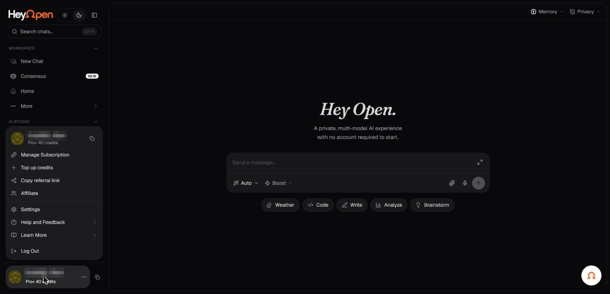

# Guest sessions, sign-in, and wallets

HeyOpen's public pages promote guest access. This means you can explore certain AI experiences without creating an account. It does **not** mean every model, saved setting, subscription, API feature, or paid action is available anonymously.

_The account menu at the foot of the sidebar. Account identifiers in the screenshots are redacted._

## Guest access

Open the app and look for a chat entry point. If a model is available to guests, you can begin without completing an account flow. A guest session may rely on browser-local state. Clearing site data or changing devices can affect locally stored conversation information.

## Signed-in access

An account or authentication step may be needed for higher limits, paid plans, API access, or account-specific settings. The model illustrations show sign-in prompts for several models, but the exact production login methods must be checked in the application.

## Wallet connection

The public application displays **Connect Wallet**. Wallet-based identity and payments are separate concepts from email or password sign-in. Connecting a wallet can expose a public blockchain address to the application and applicable service providers.

Never enter a wallet seed phrase, private key, or recovery phrase into a chat, form, or support request. Review the website, domain, wallet permissions, and transaction details before signing.

## Browser-local data

The Universal Memory page says memories are stored in the current browser, do not automatically sync between devices, and can be removed when site data is cleared. Do not assume signing into the same account on another device will restore local memory.

## If an account step is missing

Use the controls actually presented in your session. The authenticated account management flow was not accessible in the public review, so this documentation does not invent button labels or unsupported identity methods.

**Related:** [Account security](../07-plans-billing-and-account/account-security.md), [Local data and history](../06-privacy-and-security/local-data-and-history.md).
