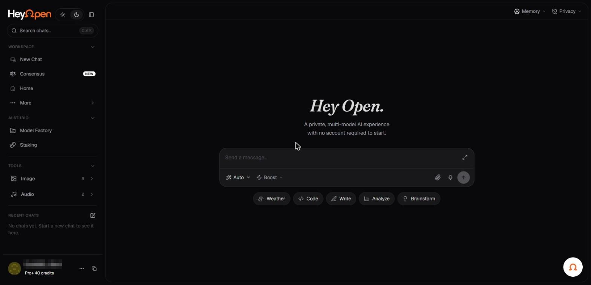

# Product and navigation tour

HeyOpen includes a marketing and information site as well as the chat application.

_The HeyOpen chat screen, signed in. Account identifiers in the screenshots are redacted._

| Destination | Purpose |
| --- | --- |
| [HeyOpen website](https://hey-open.vercel.app/) | Product capabilities, positioning, models, pricing messaging, and entry points |
| [Chat application](https://heyopen.ai/app) | Conversation interface and authenticated product functions |
| [Models](https://hey-open.vercel.app/models) | Provider catalog and model descriptions |
| [Universal Memory](https://hey-open.vercel.app/memory) | Memory behavior and user controls |
| [Private AI](https://hey-open.vercel.app/private) | Privacy architecture and product claims |
| [Product guide](https://hey-open.vercel.app/docs) | Multimodal workflow examples |
| [Terms and Privacy](https://hey-open.vercel.app/terms) | Formal service terms and disclosure links |

## What is visible in the public application

The unauthenticated application shell currently exposes **Memory**, **Privacy**, and **Connect Wallet**. The marketing site and model picker also show chat composer concepts, model selection, attachments, and task shortcuts. The precise arrangement after authentication can differ and was not publicly verifiable during this documentation review.

## A typical workflow

1. Open the application.
2. Determine whether your intended model or feature requires sign-in or a paid allowance.
3. Select a model, or choose Auto if offered.
4. Write a request. Attach supporting material only where the selected feature accepts it.
5. Review the result, refine your request, or switch to another model.
6. Review memory settings before relying on stored context or sharing information with outside models.
7. Review pricing and limits before running a high-cost operation.

**Tip:** HeyOpen may expose different capabilities based on login state, region, provider restrictions, plan, and rollout. Never assume a feature shown in a marketing illustration is available to every session.
