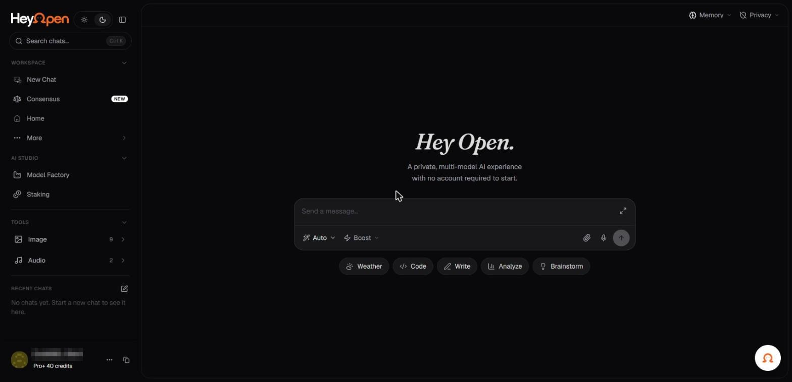

# Using the chat interface

HeyOpen centers the experience around a conversation. You describe what you need, select a model or use automatic routing, and refine the result with follow-up messages.

_The chat screen: sidebar, composer and model picker. Account identifiers in the screenshots are redacted._

## The composer

The website illustrates a single message field with suggestions such as **Weather**, **Code**, **Write**, **Analyze**, and **Brainstorm**. It also shows attachment and voice-input icons in the landing-page mockup. Exact controls depend on the deployed app and selected model.

## Build a conversation

1. State the task and desired outcome.
2. Provide only relevant background or source material.
3. Ask for a specific structure if that matters, such as a table, bullet summary, comparison, or draft.
4. Inspect the response for accuracy and omissions.
5. Continue with follow-up instructions instead of restarting for minor revisions.

## Keep the right model active

Different models have different strengths, context windows, costs, and privacy arrangements. For a question requiring visual understanding, choose a vision-capable model. For a programming review, choose a coding-capable model. For cost-sensitive work, consider Auto routing.

## Understand continuity

A chat thread can hold recent conversation history. Universal Memory is separate: it is intended for reusable preferences, decisions, and context that may apply in future conversations. Long threads can approach a model's context limit, and not every model uses identical context lengths.

## Use AI output responsibly

AI responses can be incomplete or wrong. Check sources, run generated code in a controlled environment, and review legal, financial, medical, or safety-related information with qualified professionals.

**Next:** [Better prompts](write-effective-prompts.md), [Switch models](switch-models.md), [Chat history](chat-history.md).
