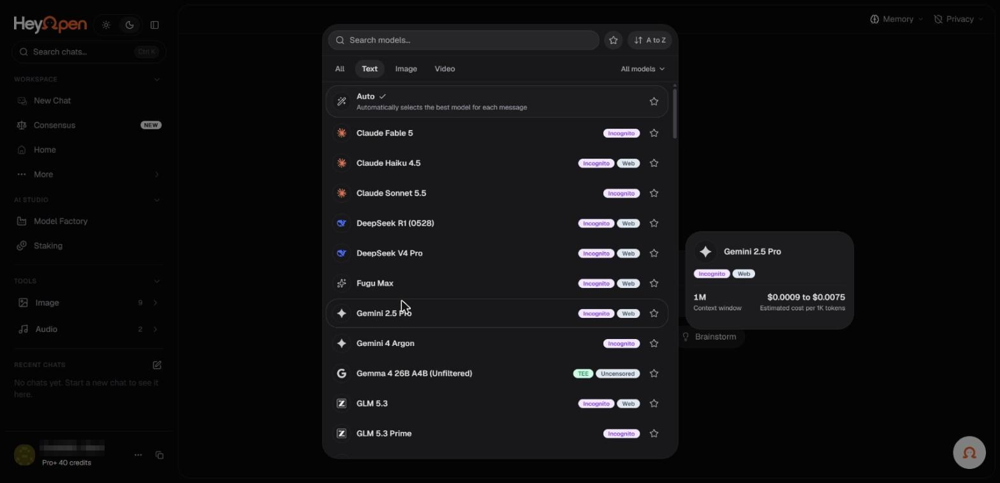

# Explore the model catalog

Hey Open advertises more than 200 models from 32 providers. The public [Models page](https://hey-open.vercel.app/models) groups AI systems across text, images, video, audio, and music, with examples from OpenAI, Anthropic, Google, xAI, DeepSeek, Meta, Mistral, Qwen, and specialized media providers.

_The model picker, with privacy and capability badges. Account identifiers in the screenshots are redacted._

## Browse by purpose

Start with the task rather than a familiar brand name. The model page offers categories and descriptions to help you identify suitable options.

| Task | Consider |
| --- | --- |
| Everyday questions | General-purpose text models |
| Complex reasoning | Reasoning-oriented models |
| Software development | Code-specialized models |
| Images or visual understanding | Vision or image models, depending on input and output |
| Long documents | Models with larger supported context windows |
| Recent web information | Models with live-search support |
| Image, video, voice, or music creation | Matching generation modality |

## What a model entry tells you

The marketing catalog provides provider, best-for description, and, for many language models, a context figure. The application illustration also includes privacy labels, sign-in requirements, and estimated token cost in some model details.

A context figure is a model capability, not a promise that every plan or product workflow lets you upload that amount in one operation.

## Availability changes

The public list can be updated as new versions launch or existing models are retired. Provider restrictions, plan eligibility, and processing routes also change. Refer to the in-app picker for the current list, pricing, and controls.

**Next:** [Choose the right model](choose-a-model.md) and [Understand privacy labels](model-labels.md).
