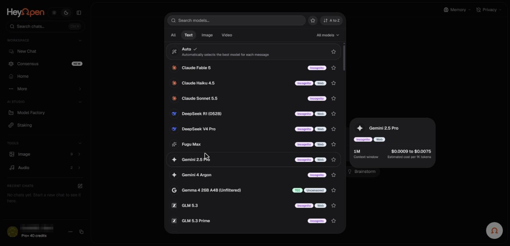

# Model badges, privacy labels, and limits

The HeyOpen model illustration shows a mixture of labels such as **Incognito**, **E2EE**, **TEE**, **web**, **vision**, and **uncensored**. These labels serve different purposes and must not be treated as equivalent guarantees.

_Model badges in the picker, and the detail card on hover. Account identifiers in the screenshots are redacted._

| Label or attribute | What to check |
| --- | --- |
| Incognito | Whether the route limits content retention and what metadata is still processed |
| E2EE | Which endpoints hold decryption keys and whether the property applies to the selected path |
| TEE | Whether inference runs inside an isolated hardware enclave and which parts of the request are covered |
| web | Whether external retrieval is enabled and may transmit queries elsewhere |
| vision | Whether the model can interpret supplied image inputs |
| uncensored | Whether a particular model has fewer content restrictions, while still following applicable law and provider terms |
| Context | Input size supported by the model or serving configuration |
| Cost | Estimated usage price or token charge, which may differ from final metering |

## Before a private request

Inspect the exact route, not simply the product's overall positioning. A TEE-backed model is different from a generic third-party endpoint. Transport encryption is distinct from end-to-end encryption. Zero retention of prompt content does not mean that billing and security metadata are never stored.

## Before a high-cost request

Review visible charges, model capabilities, context limits, and whether the action calls multiple models. Compare and media generation can use different amounts of credit from a standard text response.

If a property is not explicitly disclosed for a particular model, do not assume it applies. Consult the [Privacy Policy](https://hey-open.vercel.app/privacy-policy) for qualifications.
