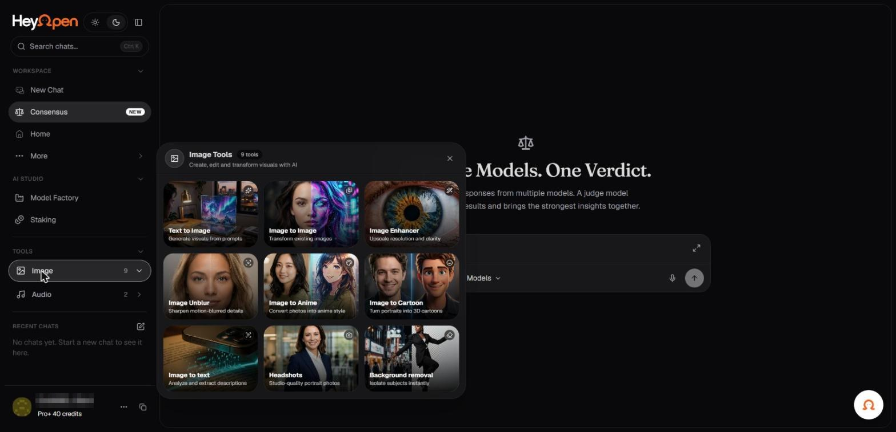

# Create and work with images

Use an image-generation model when you need a visual result such as an illustration, product concept, diagram, or creative asset. Hey Open lists image models and providers in its model catalog.

_The nine image tools. Account identifiers in the screenshots are redacted._

## Generate an image

1. Select the Images category or an available image model.
2. Describe the subject, composition, style, and desired aspect ratio.
3. Add constraints such as background, lighting, exclusions, or text requirements.
4. Generate and inspect the result.
5. Refine the prompt or use an editing function if the selected model and UI support it.

## Example prompt

> Create a minimal editorial illustration of a privacy-focused AI interface. Dark graphite background, subtle luminous lines, horizontal 16:9 composition, no company logos, with clear negative space for a headline.

## Reference images and edits

Some creative models accept an image as input while others generate from text only. If the model supports image editing, specify what to preserve and what to change. Upload only images you own or are authorized to process.

## What to check

Image dimensions, output limits, credits, download format, provider conditions, and temporary storage. Generated images may not exactly reproduce text or follow every detailed layout instruction.

## Privacy and rights

Do not upload sensitive photographs without authorization. Media may be processed by external providers and temporarily stored during generation. Check the privacy notice and the applicable terms before commercial use.
