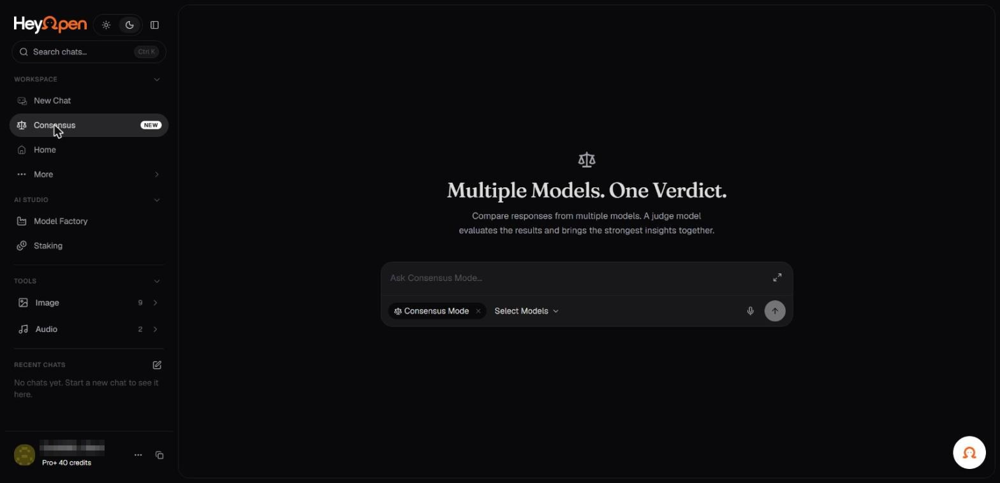

# Compare: multiple model perspectives

Compare enables several supported AI models to work on the same prompt. A configuration may compare their answers and use a separate evaluating model to synthesize or assess them.

_Compare: multiple models, one verdict. Account identifiers in the screenshots are redacted._

## What Compare is good for

- Comparing different interpretations of a complex question.
- Reviewing an argument for blind spots.
- Generating alternative approaches to a design or technical problem.
- Evaluating tradeoffs where no single answer is obviously best.

## How to use it

1. Open Compare if it is available in your account.
2. Choose the participating models or use the supported preset.
3. Add your prompt and relevant context.
4. If a judging or evaluating model is offered, review its role and cost.
5. Submit the request and compare individual responses and any synthesis.
6. Verify important facts independently before making decisions.

The website illustrates four perspectives coming together, but the Terms allow different configurations. Do not assume an exact fixed model count or a particular judging algorithm.

## Pricing considerations

Compare can trigger multiple model requests, so cost and credit consumption may exceed a single-model response. Review the estimate and usage rules before submitting.

## Privacy considerations

The same prompt and contextual information may be transmitted to multiple providers. If a judge is used, it may also receive participating models' outputs. Do not use confidential input without reviewing every participating processing route.

## What consensus does not mean

Agreement among models is not independent verification. Models can repeat common errors or draw from overlapping sources.

**Related:** [Credits](../07-plans-billing-and-account/credits-and-usage.md), [Privacy routes](../06-privacy-and-security/model-provider-privacy.md).
