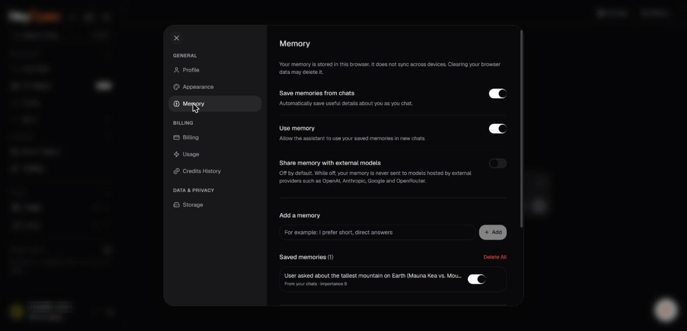

# Set up Universal Memory

Use Universal Memory when you want supported models to remember useful preferences and project context beyond an individual exchange.

_Memory settings: three switches, and the saved memories list. Account identifiers in the screenshots are redacted._

## Open the controls

The public application lists **Memory** in its entry points, and the landing-page walkthrough illustrates memory under a settings area. Open the available Memory controls in your session.

## Recommended initial setup

1. Read the note describing the current storage location and synchronization behavior.
2. Enable **Use memory** if you want retained context to be available in new chats.
3. Decide whether to turn on automatic memory generation from conversations.
4. Add a simple preference manually, such as your preferred response format.
5. Review the **Share memory with external models** setting before using third-party providers.
6. Test with a new conversation and inspect whether the desired context was applied.

## Choose what belongs in memory

Prefer durable preferences, active project constraints, and decisions that will matter in future sessions. Avoid storing one-time secrets, passwords, private keys, financial account credentials, or unrelated sensitive information.

## Verify persistence

Because the product page describes browser-local storage, test persistence in the same browser before relying on it. Do not assume memories move automatically to another device or browser profile.

## If your controls differ

Names and locations may change during product updates. Use the options actually shown in the deployed app. Some memory features may depend on account state, browser configuration, or rollout.
