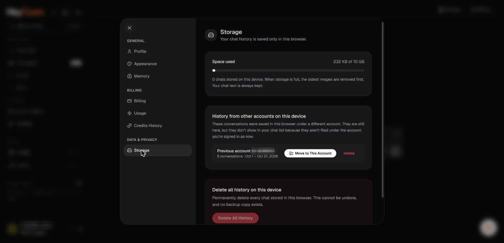

# Local history, storage, and deletion

Hey Open's product material describes browser-local conversation history and Universal Memory. Data stored in a browser can behave differently from information associated with a server-side account.

_Storage: chat history is kept in this browser. Account identifiers in the screenshots are redacted._

## What may be local

The memory page explicitly says saved memory is stored in the current browser and does not automatically sync. The privacy page also describes conversations being available in the browser. The actual stored objects and their persistence depend on the deployed app.

## Clearing local data

Deleting site data through your browser can remove local memory and potentially session information or settings. Before doing so, save any outputs you need elsewhere. Browser privacy modes, storage permissions, and device changes can also affect persistence.

## Deleting an account

An account deletion request is different from deleting local files or site storage. Some account, payment, security, or legal records may be retained when required by law or legitimate operational needs. Local browser memory may need to be cleared separately.

## What local deletion cannot do

Removing local information cannot necessarily undo content processing already performed by a third-party provider, reverse transactions on public blockchains, or erase records from external tools or agent-connected systems.

## How to request help

For requests involving account data, corrections, access, or deletion, contact **support@heyopen.ai**. The Privacy Policy states that identity verification may be requested and that statutory timelines apply.

**Read:** [Your data rights](your-data-rights.md), [Universal Memory controls](../05-universal-memory/manage-memories.md).
