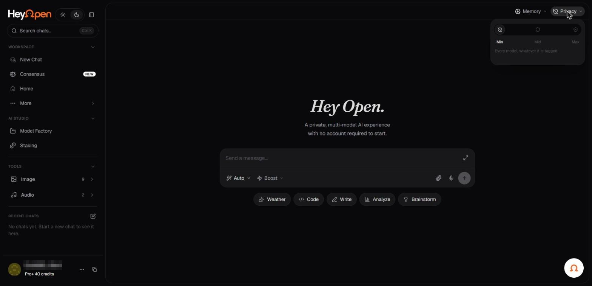

# Privacy at a glance

Privacy is a central part of HeyOpen's positioning. The product promotes secure routing, reduced conversation retention, and privacy-enhanced model choices. The exact protections depend on your selected model, feature, provider, and processing route.

_The privacy filter, set to Min. Account identifiers in the screenshots are redacted._

## Key principles

**Data minimization:** HeyOpen's policy says it seeks to reduce unnecessary access to and retention of private conversation content.

**Provider-specific processing:** External AI providers may receive the prompt and context necessary to answer your request.

**Conditional zero retention:** Certain routes may use verified zero-data-retention arrangements. This does not necessarily cover every model, media workflow, billing record, or operational log.

**User-managed memory:** The public Universal Memory page describes local browser storage and controls over retained context and external-model sharing.

**Separate operational data:** Account identifiers, payment records, usage information, and security events may still be processed and retained for legitimate purposes.

## Before sending sensitive material

1. Inspect the exact model and privacy route.
2. Determine whether external model providers are involved.
3. Review the relevant retention and training disclosures.
4. Minimize or remove unnecessary identifying details.
5. Use a specifically approved protected route for organizational data.
6. Avoid disclosing passwords, private keys, and secrets.

## Privacy is not anonymity in every context

Guest access may reduce registration requirements, but network metadata, payment records, and publicly visible blockchain transactions can still create identifiers. An on-chain payment is not equivalent to an anonymous payment.

**Official policy:** [Privacy Policy](https://hey-open.vercel.app/privacy-policy). Read [Privacy across model providers](model-provider-privacy.md) for further detail.
