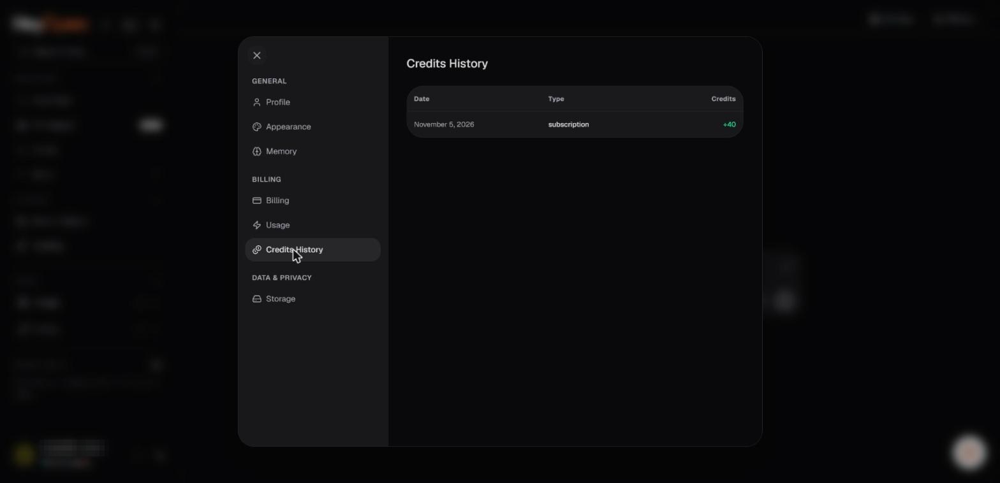

# Receipts and billing history

For subscriptions and credit purchases, keep a copy of each receipt and payment reference. The Hey Open Privacy Policy states that subscription records, purchase history, transaction confirmations, and invoices may be retained as necessary for billing, accounting, compliance, and dispute resolution.

_Credits History. Account identifiers in the screenshots are redacted._

## Information to check on a receipt

- Account or billing identifier.
- Payment or transaction reference.
- Purchase date and billing period.
- Product or plan purchased.
- Currency, subtotal, taxes, and total charged.
- Payment status and method.

## Finding an invoice

Use the billing or payment history area in your account if that control is present. The exact production UI was not publicly accessible during review, so there is no verified deep link to an invoice page.

## Cryptocurrency proof

A transaction hash can help confirm on-chain settlement, but a blockchain transfer alone does not prove that the application assigned the payment to the correct product or account. Keep the checkout reference and contact support if the account is not updated.

## Correcting an invoice or charge

Contact **support@heyopen.ai** with the receipt number or transaction reference and a clear explanation. Do not send complete payment-card details or credentials.

**Related:** [Payment methods](payment-methods.md), [Billing troubleshooting](../11-help-and-troubleshooting/billing-troubleshooting.md).
