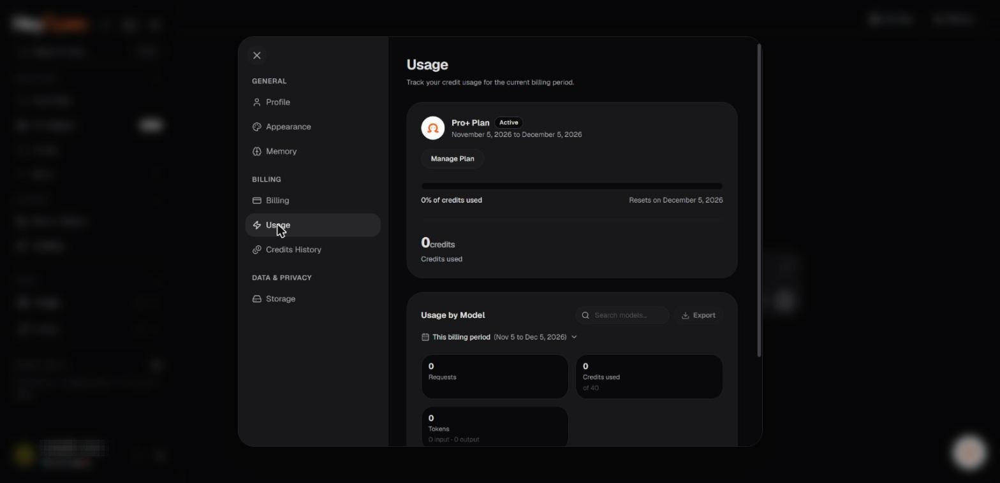

# Credits, usage, and metering

Hey Open's Terms describe **usage credits** that may be included in subscriptions, purchased separately, or issued through promotions. Credits may be consumed by eligible AI models, media tools, API requests, Consensus Mode, or agents.

_Usage for the current billing period. Account identifiers in the screenshots are redacted._

## Why charges vary

Different models and features have different processing costs. Metering may depend on input and output tokens, media generation, request complexity, provider usage reporting, or multiple model calls in the same workflow.

## Monitor your balance

Use the available billing or usage view to review your credit balance and recent consumption. If a feature displays an estimate, remember that final metering can vary because of tokenization, provider reporting, or request configuration.

## Understand different credit types

- **Subscription credits:** Included with a paid plan if specified.
- **Purchased credits:** Added through a separate payment if supported.
- **Promotional credits:** Issued through an eligible offer with its own conditions.

The public Terms contain unresolved placeholders for expiry, usage rounding, failed-request billing, and negative-balance treatment. Those details must be confirmed in the final product policies before publication as fixed rules.

## Avoid surprises

Choose an appropriate model, monitor estimated cost, set spending limits where available, and pay attention to workflows that invoke multiple models. Automatic routing can help optimize usage but does not guarantee a specific cost reduction.

## Insufficient credits

The platform may restrict chargeable requests when your balance or spending limits are insufficient. Check your plan, refresh status, and available credit-purchase options.

**Related:** [Auto routing](../03-models-and-routing/auto-routing.md), [Consensus Mode](../05-universal-memory/consensus-mode.md).
