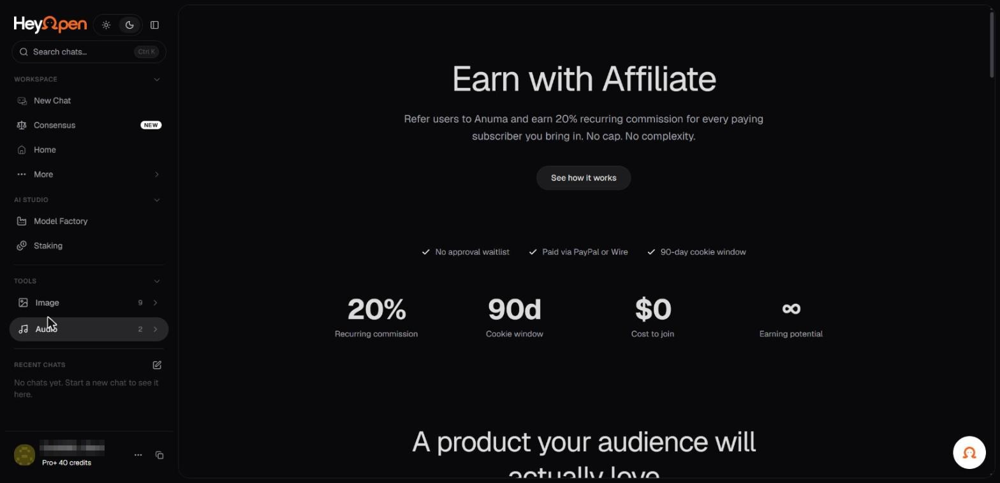
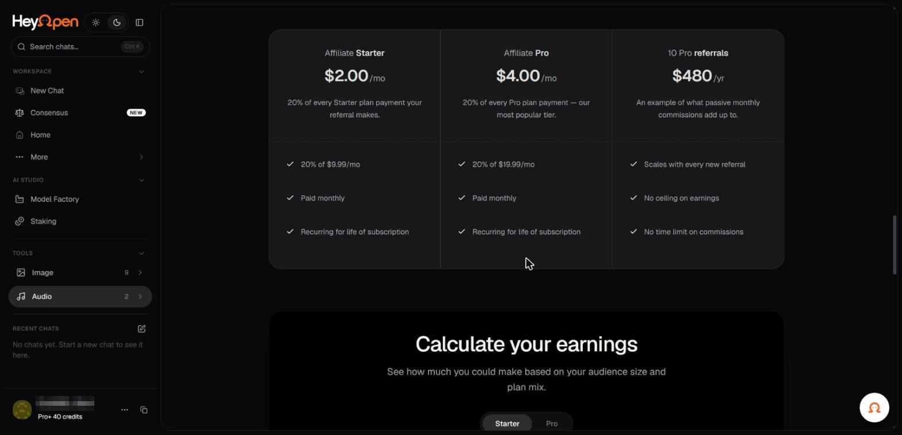
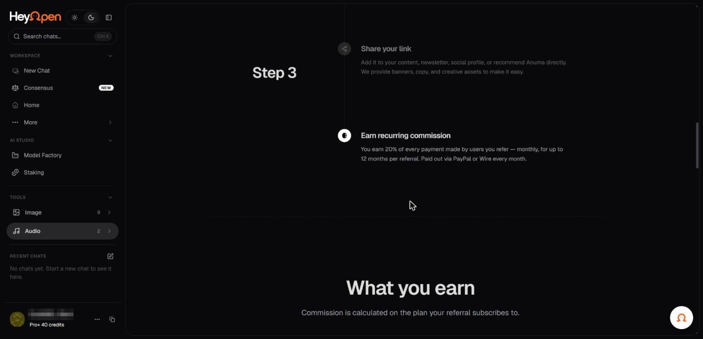
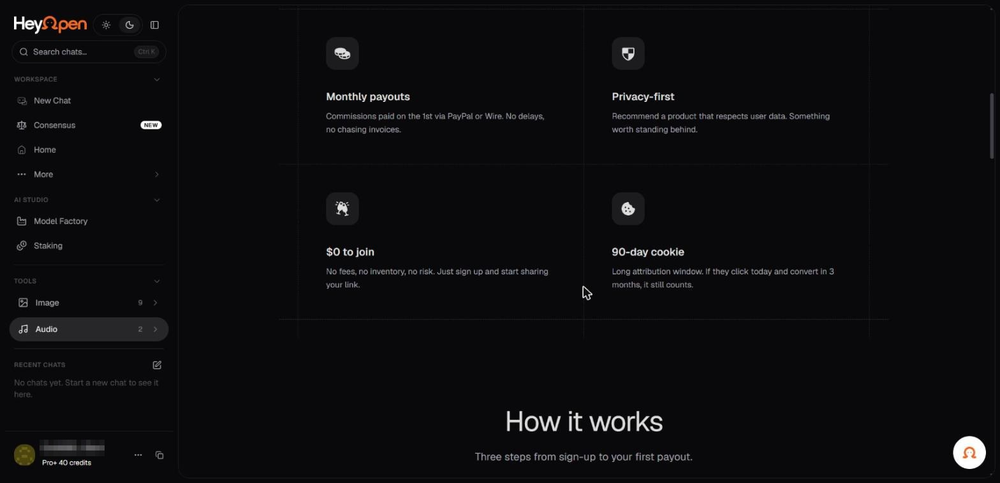

# Referrals and the affiliate programme

Hey Open pays a commission for users you refer who go on to subscribe. There are two
entry points, both in the account menu at the foot of the sidebar: **Copy referral
link**, which gives you your link straight away, and **Affiliate**, which opens the
programme page with the terms, a dashboard and an earnings calculator.

_The affiliate programme page, reached from Affiliate in the account menu._

## What the programme pays

| Term | What the page states |
| --- | --- |
| Commission | 20% of every payment made by a user you refer |
| Duration | Up to 12 months per referral |
| Attribution window | 90 days from the click |
| Cost to join | $0, with no approval waitlist |
| Application review | Within 48 hours |
| Payout schedule | The 1st of each month, for the previous month |
| Payout method | PayPal or wire transfer |
| Minimum payout | $25 |
| Referral cap | None |

_Commission is calculated on the plan the referral subscribes to._

## How it works

1. **Apply.** Complete a short application. It is reviewed within 48 hours, after which
   you receive your referral link and dashboard access.
2. **Share your link.** It works anywhere: a blog, a newsletter, social media, a podcast,
   a video description. Banners, copy snippets and email templates are provided.
3. **Earn.** Commission accrues on each payment your referrals make and is paid monthly.

_Three steps from application to first payout._

## What counts as a referral

A referral is someone who clicks your link and creates a **paid** account within 90 days.
Free sign-ups earn nothing; only paid conversions do. If a referral later upgrades their
plan, your commission adjusts to 20% of the new price for the remainder of their window.

_Monthly payouts, a real-time dashboard, creative assets and a 90-day cookie._

## What partners get

A real-time dashboard for clicks, conversions and earnings; a library of banners, copy
and email templates; and a named contact for questions, custom campaigns and
co-marketing.

## Before you promote it

> **Two things on this page need settling before it is quoted to partners.**
>
> **The programme page names the wrong product.** Its copy refers throughout to
> "Anuma" rather than Hey Open, and the commission examples are calculated against
> $9.99 and $19.99 plans that do not match Hey Open's published pricing. The page
> appears to carry template copy that was never rebranded.
>
> **The duration contradicts itself.** The summary cards say commission is "recurring
> for life of subscription" with "no time limit on commissions", while the steps and
> the FAQ both say "up to 12 months per referral". These cannot both be right.

Confirm the commission rate, the duration and the plan prices with the team before
relying on any figure here.
