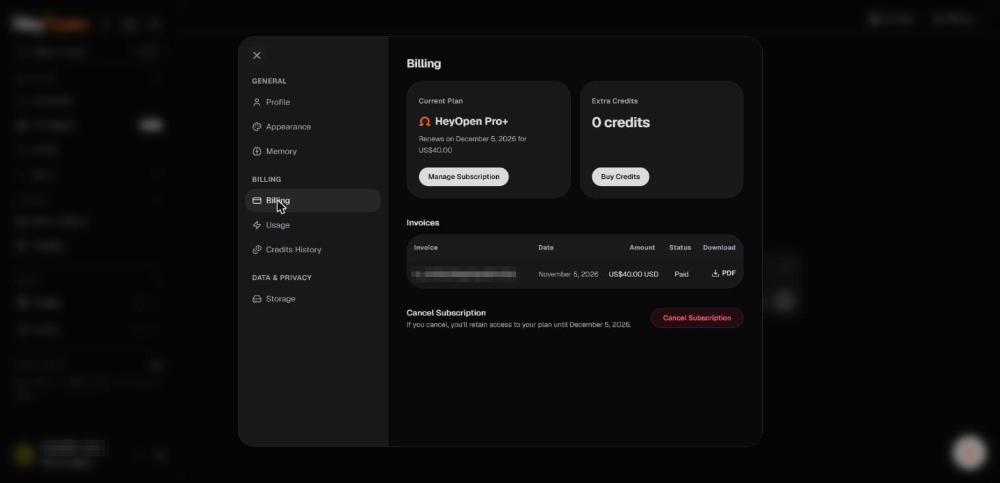

# Manage your subscription

HeyOpen subscriptions provide access to plan-specific functionality for a defined billing period. The published Terms describe recurring subscriptions that generally renew automatically unless checkout states otherwise.

_The Billing tab: current plan, extra credits and invoices. Account identifiers in the screenshots are redacted._

## Start a subscription

Open the current pricing or plan management flow. Choose the plan and billing period, review available payment methods and included benefits, then confirm the full charge before completing payment. The actual checkout UI and identity requirements may differ from the marketing page.

## Renewals

For recurring subscriptions, the Terms state that the subscription normally renews for successive billing periods until canceled. You must cancel before the applicable renewal date to avoid the next charge, subject to local consumer protections.

## Manual crypto renewal

Cryptocurrency-funded subscriptions may require manual renewal. Review the checkout disclosure instead of assuming automatic charging or access extension.

## Change a plan

If upgrades or downgrades are available, the effective date, price adjustment, allowances, and next billing date should be shown before confirmation. Do not assume every change is applied immediately.

## Cancel

The Terms state that eligible paid access generally continues through the current paid period after cancellation. See [Cancellation and refunds](cancellation-and-refunds.md).

## Where to manage your plan

Use the account's subscription controls if present. The precise production settings route could not be verified publicly. The Terms also allow contacting **support@heyopen.ai** for cancellation assistance.
