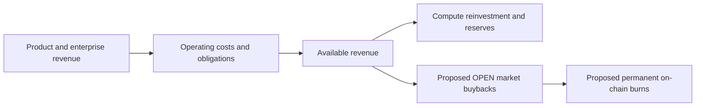

# Revenue, buybacks, and permanent burns

Hey Open's business model connects product usage to enterprise infrastructure and, in the proposed token economy, to potential $OPEN buybacks and permanent on-chain burns.

## Revenue sources described by the site

1. Enterprise inference and API services.
2. Hey Open subscription payments.
3. Pay-as-you-go AI inference.
4. Agent and compute marketplace activity.

## Conceptual allocation

Revenue is not the same as distributable profit. The website describes costs including inference, infrastructure, compute, reserved obligations, and liabilities related to credits. A proposed allocation would use a portion of available revenue after applicable costs for open-market $OPEN purchases and burns.

## Why burns are different from fees

A buyback acquires tokens in the market. A burn removes tokens from circulation by transferring them to a verifiable burn mechanism. Neither necessarily guarantees a higher market price. The actual economics depend on the policy, amount, timing, market liquidity, and execution.

## Publication status

The website has differing present-tense and proposed descriptions of token operations. This guide does not assert that scheduled automated burns are already executing. An official production page should link verifiable transaction records and a finalized policy before making such a claim.
