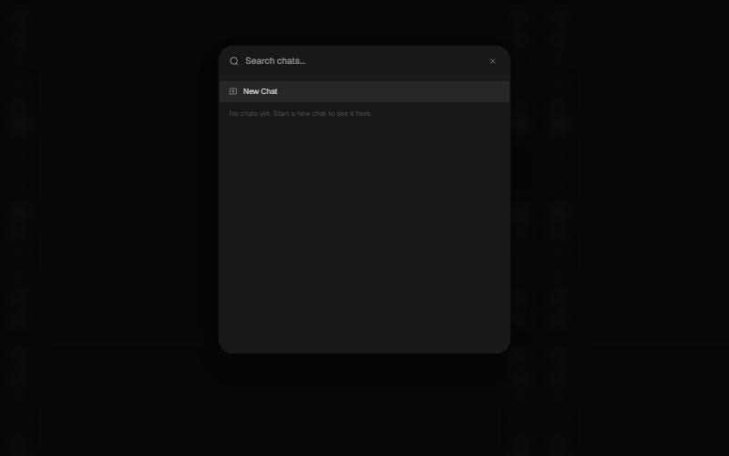

# Account and data

## Signing in

The header and the sidebar foot both offer **Connect Wallet**. Every
model in the picker shows **Sign in**.


**Needs confirming:** The full list of sign-in methods. Only Connect Wallet is visible signed out; whether email or social sign-in exists was not established.


## Themes

Light, dark and system themes are selectable from the sidebar header.

## Recent chats and search

The sidebar keeps a **Recent chats** list with a new-chat control. Chat
search is at the top of the sidebar, or **Ctrl K**.

## Invite and earn

**Invite & Earn $10** sits at the foot of the sidebar.


**Needs confirming:** Referral terms: what the inviter and the invitee each receive, when it pays out, and any cap.


## Your data


**Needs confirming:** Whether conversations can be exported, whether memory can be exported or imported, what deleting a conversation removes, and what deleting an account removes. None of this was visible signed out. Account deletion is irreversible, so nothing should be published until it has been QA tested.


---

### Related

- [Memory](../chat/memory.md)
- [Signing in and accounts](../getting-started/accounts.md)

*Snapshot taken from the live application on 4 November 2026. The app is the source of truth; this page is a snapshot.*

