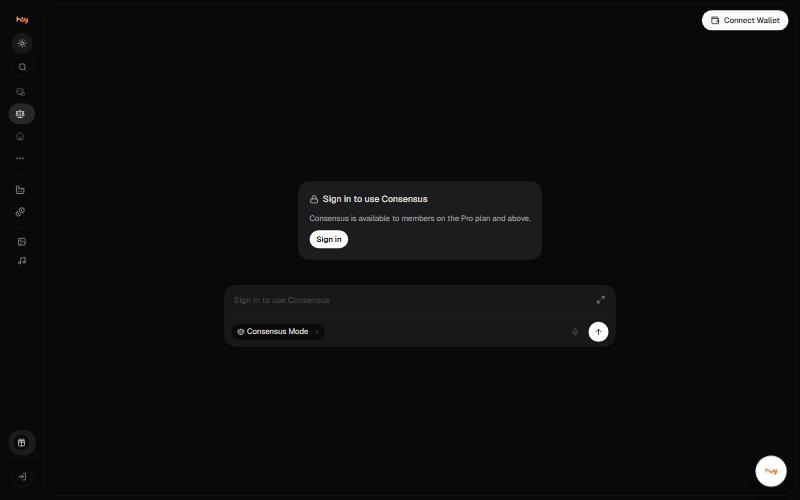

# Consensus Mode

Consensus Mode sends one prompt to several models and shows their answers
together, so you can see where they disagree.

## Availability

Consensus is **available to members on the Pro plan and above** and
requires signing in. Opening it without an account shows a sign-in gate.

## Good to know

- Agreement between models is not proof. Models can share training data and repeat the same error.
- Every participating model consumes usage. One Consensus question can cost several times a single-model turn.
- Use it for a decision worth the cost, not for everyday questions.


**Needs confirming:** How many models take part, whether the user chooses them, whether a judge model synthesises the answer, and how the run is charged.


---

### Related

- [Choosing the right model](model-selection.md)
- [Plans and billing](../getting-started/accounts.md)

*Snapshot taken from the live application on 4 November 2026. The app is the source of truth; this page is a snapshot.*

