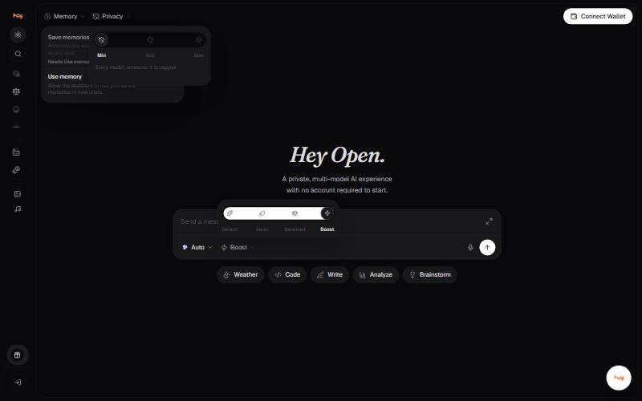

# Memory

Memory keeps useful details about you so you do not have to re-explain
yourself to each new model. It is reached from **Memory** in the header.

## The two switches

| Switch | What it does |
| --- | --- |
| **Save memories from chats** | Automatically saves useful details about you as you chat. Requires **Use memory** to be on. |
| **Use memory** | Lets the assistant use your saved memories in new chats. |

Turning **Use memory** off disables saving as well, because the save
switch depends on it.

## Good to know

- Memory is not chat history. It stores selected facts, not transcripts.
- Memory is sent to whichever model answers, so it is subject to that model's privacy route. Raise the [privacy filter](privacy-filter.md) before putting anything sensitive in memory.


**Needs confirming:** Where memory is stored, whether it is encrypted, whether it syncs across devices, the size limit, and whether it can be exported or imported.


---

### Related

- [Privacy filter](privacy-filter.md)
- [Your first conversation](../getting-started/first-conversation.md)

*Snapshot taken from the live application on 4 November 2026. The app is the source of truth; this page is a snapshot.*

