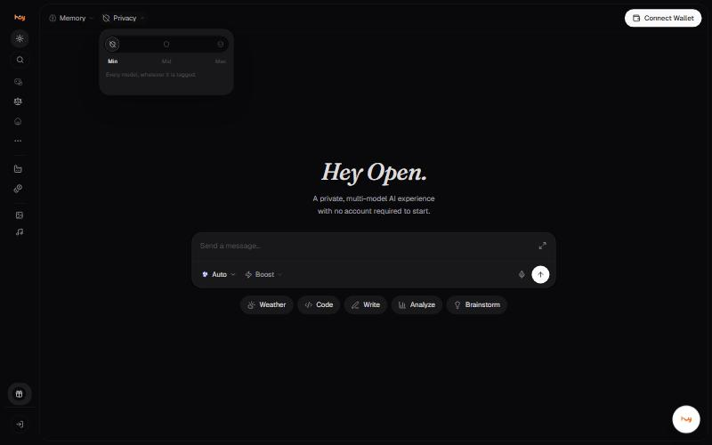

# Privacy filter: Min, Mid and Max

The privacy filter sits in the header next to **Memory**. It decides which
models you are allowed to use, by how strongly the route protects the
prompt.

| Setting | What it allows | Models available |
| --- | --- | --- |
| **Min** | Every model, whatever it is tagged. | All 64 text models |
| **Mid** | Private, TEE and E2EE models only. | 9 text models |
| **Max** | TEE and E2EE models only, hardware-protected prompts. | 8 text models |

## What the badges mean

| Badge | Meaning |
| --- | --- |
| **Incognito** | Routed so the provider does not receive your identity. Assume the provider still processes the prompt under its own terms. |
| **Private** | Runs under zero-data-retention terms. |
| **TEE** | Trusted Execution Environment. Inference runs inside a hardware-isolated enclave. |
| **E2EE** | End to end encrypted. Encrypted on your device, decrypted only inside a verified enclave. |

## Good to know

- Raising the filter removes models from the picker. If a model you use disappears, check this setting first.
- **Incognito** is the weakest of the four. It hides who you are from the provider; it does not stop the provider keeping the prompt.
- HTTPS in transit is not end to end encryption. Only **E2EE** means the prompt is encrypted before it leaves your device.
- The filter applies to text models. Image and video models carry their own badges.


**Needs confirming:** Whether the privacy filter persists across sessions and devices, and whether changing it mid-conversation starts a new one.


---

### Related

- [Choosing the right model](model-selection.md)
- [Request mode](request-mode.md)

*Snapshot taken from the live application on 4 November 2026. The app is the source of truth; this page is a snapshot.*

