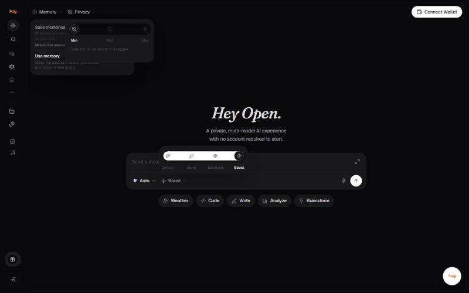

# Request mode

The request mode sets which providers the gateway reaches for first. It
sits next to the model pill under the composer and reads **Boost** by
default in the current build.

| Mode | What it does |
| --- | --- |
| **Default** | Every model; the gateway picks the vendor. |
| **Saver** | Cheapest providers first. |
| **Balanced** | A balance of speed and cost. |
| **Boost** | Fastest providers first. |

## Choosing one

- **Saver** when the task is routine and you care about cost.
- **Balanced** for general work.
- **Boost** when you are waiting on the answer.
- **Default** when you want the gateway to decide without a bias.

## Good to know

- Some models are marked **Not in Boost** and disappear from the picker in that mode.
- Request mode is about provider selection. It is not the same thing as the [privacy filter](privacy-filter.md), which decides which models are allowed at all.
- Switching mode does not change the model you have pinned; it changes which vendor serves it.


**Needs confirming:** Whether request mode changes the price of a request, and by how much. The labels imply a cost difference but the app does not state one.


---

### Related

- [Choosing the right model](model-selection.md)
- [Privacy filter](privacy-filter.md)

*Snapshot taken from the live application on 4 November 2026. The app is the source of truth; this page is a snapshot.*

