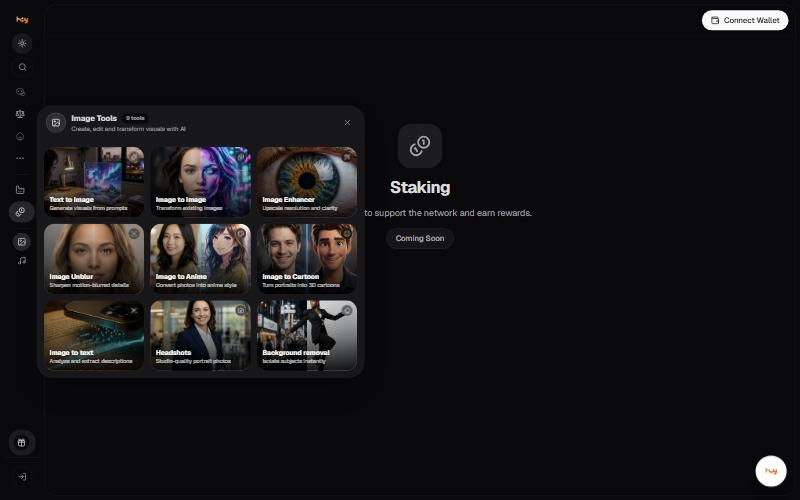

# Image Tools

9 single-purpose tools, reached from the sidebar. Each does one job,
so you do not have to describe it in a prompt.

| Tool | What it does |
| --- | --- |
| **Text to Image** | Generate visuals from prompts |
| **Image to Image** | Transform existing images |
| **Image Enhancer** | Upscale resolution and clarity |
| **Image Unblur** | Sharpen motion-blurred details |
| **Image to Anime** | Convert photos into anime style |
| **Image to Cartoon** | Turn portraits into 3D cartoons |
| **Image to text** | Analyze and extract descriptions |
| **Headshots** | Studio-quality portrait photos |
| **Background removal** | Isolate subjects instantly |

## Good to know

- These are separate from the image models in the chat picker. Use a tool when the job is one of the nine above; use a model when you need a prompt.
- The panel opens over whatever screen you are on.


**Needs confirming:** Whether the tools consume the same credits as image models, what resolutions they output, and whether any require signing in.


---

### Related

- [Images](images.md)
- [Audio Tools](audio-tools.md)

*Snapshot taken from the live application on 4 November 2026. The app is the source of truth; this page is a snapshot.*

