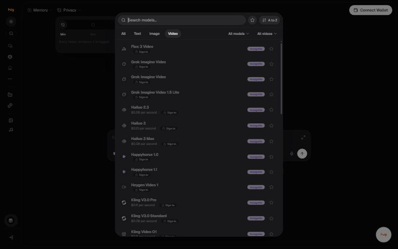

# Images

35 image models sit in the same picker as chat, under the **Image**
tab.

## Generating from a prompt

| Model | Badges |
| --- | --- |
| Flux 2 Klein | Private, Not in Boost |
| Flux Dev | Incognito, Not in Boost |
| Flux Kontext Max | Incognito, Not in Boost |
| Flux Kontext Pro | Incognito, Not in Boost |
| Flux Pro | Incognito, Not in Boost |
| Flux Pro V1.1 | Incognito, Not in Boost |
| Flux Pro V1.1 Ultra | Incognito, Not in Boost |
| Flux Realism | Incognito, Not in Boost |
| Flux Schnell | Incognito, Not in Boost |
| Gemini 2.5 Flash Image | Incognito |
| Gemini 3 Pro Image | Incognito, Image required |
| Gemini 3.1 Flash Lite Image | Incognito, Image required |
| Gemini Flash Image | Incognito, Image required |
| GPT 5 Image | Incognito, Image required |
| GPT 5 Image Mini | Incognito, Image required |
| GPT 5.4 Image 2 | Incognito, Image required |
| GPT Image 2 | Incognito, Image required |
| Grok Imagine Image 2.0 | Incognito, Image required |
| Nano Banana Pro | Incognito, Image required |
| Qwen Image Edit (Unfiltered) | Incognito, Uncensored |
| Seedream V4.5 (Unfiltered) | Incognito, Uncensored, Image required |
| Seedream V5 Lite (Unfiltered) | Incognito, Uncensored |
| Seedream V5 Pro (Unfiltered) | Incognito, Uncensored |
| Z Image (Unfiltered) | Incognito, Uncensored |
| Z Image Pro (Unfiltered) | Incognito, Uncensored |

## Editing an existing image

These take a source image. 11 models across the tab are marked
**Image required** and cannot generate from text alone.

| Model | Badges |
| --- | --- |
| Gemini 2.5 Flash Image Edit | Incognito |
| Gemini 3 Pro Image Edit | Incognito |
| Gemini 3.1 Flash Lite Image Edit | Incognito |
| Gemini Flash Image Edit | Incognito |
| GPT 5 Image Edit | Incognito |
| GPT 5 Image Mini Edit | Incognito |
| GPT 5.4 Image 2 Edit | Incognito |
| GPT Image 2 Edit | Incognito |
| Grok Imagine Edit | Incognito, Image required, Not in Boost |
| Grok Imagine Image 2.0 Edit | Incognito |

## Writing a prompt

| Element | Example |
| --- | --- |
| Subject | A private AI workspace as modular glass panels |
| Style | Editorial illustration, restrained |
| Palette | Neutral background, blue-grey |
| Lighting | Soft directional |
| Composition | Wide 16:9, generous negative space |
| Exclusions | No text, no logos |

## Good to know

- Nine Flux models are marked **Not in Boost** and disappear in that request mode.
- Models ending in **Edit** expect a source image.
- Models marked **(Unfiltered)** have reduced content filtering. Law and the Terms still apply.
- Each regeneration is a new charge. Decide what is wrong before pressing it again.


**Needs confirming:** Output resolutions, aspect ratios and per-image cost. None are shown in the picker.


---

### Related

- [Video](video.md)
- [Image Tools](image-tools.md)
- [Choosing the right model](../chat/model-selection.md)

*Snapshot taken from the live application on 4 November 2026. The app is the source of truth; this page is a snapshot.*

