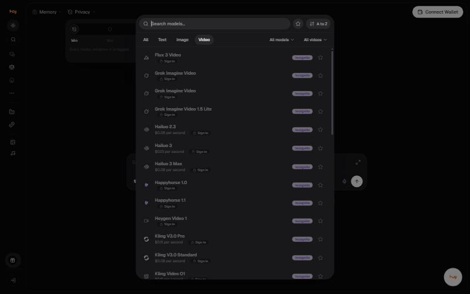

# Video

34 video models, under the **Video** tab in the picker. 13 of them
publish a price per second of output, which makes video the one place in
the product where cost is visible before you commit.

## Priced models

| Model | Per second | 10 second clip | Badges |
| --- | --- | --- | --- |
| Seedance 1.5 Pro | $0.02 | $0.20 | Incognito |
| Seedance 2.0 Mini | $0.03 | $0.30 | Incognito |
| Seedance 2.0 Fast | $0.04 | $0.40 | Incognito |
| Hailuo 2.3 | $0.08 | $0.80 | Incognito |
| Hailuo 3 Max | $0.08 | $0.80 | Incognito |
| Kling V3.0 Standard | $0.08 | $0.80 | Incognito |
| Wan 2.7 | $0.10 | $1.00 | Incognito |
| Kling V3.0 Pro | $0.11 | $1.10 | Incognito |
| Kling Video O1 | $0.11 | $1.10 | Incognito |
| Runway Gen4.5 | $0.12 | $1.20 | Incognito, Image required |
| Hailuo 3 | $0.13 | $1.30 | Incognito |
| Wan 3.0 | $0.20 | $2.00 | Incognito, Image required |
| Wan 3.0 Prime | $0.28 | $2.80 | Incognito |

The range is wide: ten seconds costs **$0.20** on Seedance 1.5 Pro and **$2.80** on Wan 3.0 Prime, a factor of 14.

## Models without a published price

| Model | Badges |
| --- | --- |
| Flux 3 Video | Incognito |
| Grok Imagine Video | Incognito |
| Grok Imagine Video 1.5 Lite | Incognito |
| Happyhorse 1.0 | Incognito |
| Happyhorse 1.1 | Incognito |
| Heygen Video 1 | Incognito |
| Mischief 1 | Incognito |
| Seedance 2.0 | Incognito |
| Seedance 2.5 (Unfiltered) | Incognito, Uncensored |
| Seedance Pro V1.5 (Unfiltered) | Incognito, Uncensored |
| Veo 3.1 | Incognito |
| Veo 3.1 Fast | Incognito |
| Veo 3.1 Lite | Incognito |
| Wan 2.6 | Incognito |
| Wan 2.6 (Unfiltered) | Incognito, Uncensored |
| Wan 2.7 (Unfiltered) | Incognito, Uncensored |
| Wan 3.0 (Unfiltered) | Incognito, Uncensored |
| Wan 3.0 Prime (Unfiltered) | Incognito, Uncensored |
| Wan 3.0 Prime Pro (Unfiltered) | Incognito, Uncensored |
| Wan 3.0 Pro (Unfiltered) | Incognito, Uncensored |

## Planning a shot

| Element | Example |
| --- | --- |
| Subject and action | Rain running down a glass office wall at dusk |
| Camera | Locked off, slow focus pull to a distant skyline |
| Duration | Six seconds |
| Mood | Muted blue light |
| Exclusions | No text, no captions |

## Good to know

- **Image required** models need a starting frame: Runway Gen4.5 and Wan 3.0 both do.
- Price is per second of **output**, so clip length is the main cost lever.
- Media jobs queue differently from chat. Do not treat an unconfirmed job as a finished asset.


**Needs confirming:** Maximum clip length per model, output resolution, whether audio is included, and whether a cancelled or failed job is charged.


---

### Related

- [Images](images.md)
- [Choosing the right model](../chat/model-selection.md)

*Snapshot taken from the live application on 4 November 2026. The app is the source of truth; this page is a snapshot.*

