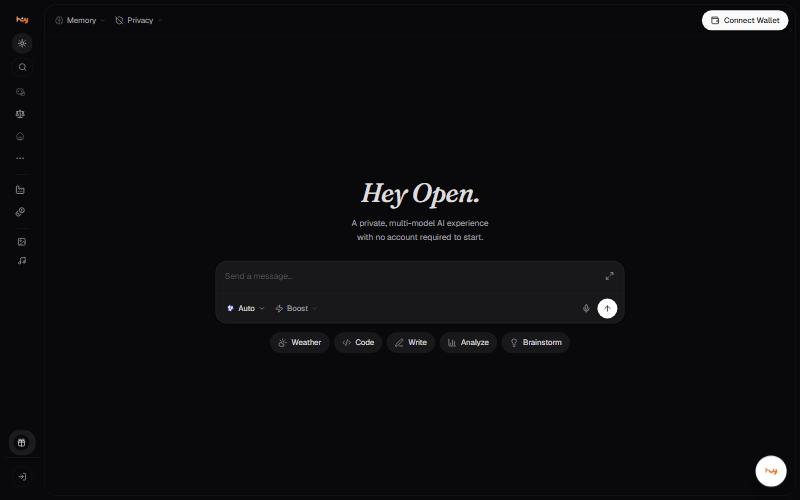

# Your first conversation

1. Open [ais.openledger.xyz](https://ais.openledger.xyz/chat). The composer is in the middle of the screen.
2. Leave the model on **Auto** for now, or open the picker and choose one.
3. Type a question and press send. Try: *"Explain how an API rate limiter works. Use a simple analogy first, then give a Node.js example."*
4. Read the answer for scope before accuracy: did it answer the question you meant?
5. Follow up in the same thread. *"Now add an example using Redis and explain the trade-offs."*

## Shortcuts on the empty screen

Five starters sit under the composer: **Weather**, **Code**, **Write**,
**Analyze** and **Brainstorm**. They fill the composer with a starting
prompt.

## If the answer is weak

- Too broad: say what to keep, what to cut, and what a good answer looks like.
- Misunderstood: ask the model to state its assumptions before continuing.
- Confidently wrong: check it elsewhere, or ask a second model to critique it. A second opinion sharpens scrutiny; it does not prove correctness.

## Good to know

- Sending a message requires signing in. The composer is visible either way.
- A long thread costs more per turn than a short one, because earlier turns are resent as context.

---

### Related

- [Choosing the right model](../chat/model-selection.md)
- [Memory](../chat/memory.md)

*Snapshot taken from the live application on 4 November 2026. The app is the source of truth; this page is a snapshot.*

