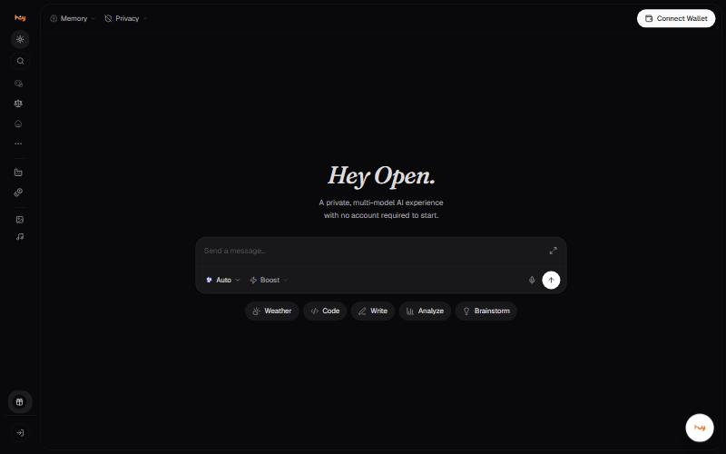
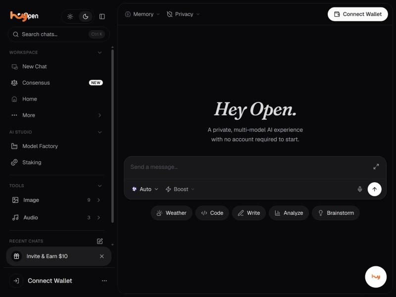

# What is Hey Open?

Hey Open is a private, multi-model AI workspace. One app gives you every
leading AI model with a privacy setting you choose per conversation, a
memory that follows you between models, and a creative suite for images,
video and audio in the same place.

**Available on:** web at [ais.openledger.xyz](https://ais.openledger.xyz/chat).
The app opens straight into a chat. You can read the whole model
catalogue without connecting a wallet; sending a message requires signing
in.

*Snapshot last updated: 4 November 2026.*

## Every model, one workspace

Switching AI apps normally means starting over. In Hey Open you pick the
model per task and keep the same thread: 64 text models from OpenAI,
Anthropic, Google, xAI, DeepSeek, Qwen, Kimi, Mistral and others, plus
35 image models and 34 video models. 133 in total.

Leave it on **Auto** and the gateway picks for you. See
[Choosing the right model](../chat/model-selection.md).

## Privacy you set per conversation

Most products make privacy an account setting. Hey Open makes it a filter
in the header that decides which models you are allowed to use at all.

| Setting | What it allows |
| --- | --- |
| **Min** | Every model, whatever it is tagged. |
| **Mid** | Private, TEE and E2EE models only. |
| **Max** | TEE and E2EE models only, hardware-protected prompts. |

Raising the filter removes models from the picker. On **Max** only the
8 hardware-protected
models remain. See [Privacy filter](../chat/privacy-filter.md).

## Speed or cost, per request

Separately from privacy, a **request mode** on the composer decides which
providers the gateway reaches for first.

| Mode | What it does |
| --- | --- |
| **Default** | Every model; the gateway picks the vendor. |
| **Saver** | Cheapest providers first. |
| **Balanced** | A balance of speed and cost. |
| **Boost** | Fastest providers first. |

See [Request mode](../chat/request-mode.md).

## What else you can do

- **Consensus Mode.** Ask several models at once and compare their answers. Pro plan and above. See [Consensus Mode](../chat/consensus.md).
- **Memory.** Saved details about you, reused in new chats, with two switches that control saving and use. See [Memory](../chat/memory.md).
- **Create.** 35 image models and 34 video models, 13 of which publish a price per second. See [Images](../create/images.md) and [Video](../create/video.md).
- **Image Tools.** 9 single-purpose tools: Text to Image, Image to Image, Image Enhancer, Image Unblur and more. See [Image Tools](../create/image-tools.md).
- **Audio Tools.** 3 tools: Text to speech, Text to Music, Voice to text. See [Audio Tools](../create/audio-tools.md).
- **Agents.** A marketplace of specialised agents. See [Agents](../workspace/agents.md).
- **Community Feed.** Dated image and video posts on the home screen.

## Navigating

The sidebar groups everything into three areas, plus your recent chats.

| Group | Contains |
| --- | --- |
| **Workspace** | New Chat, Consensus, Home, More |
| **AI Studio** | Model Factory, Staking |
| **Tools** | Image (9), Audio (3) |

**More** opens Agents, Community Feed, API, Token Dashboard.
See [Getting around the workspace](workspace.md).

## Plans

| Plan | Price | What you get |
| --- | --- | --- |
| Free | $0 | Browsing the catalogue, Image Tools and Audio Tools. Sending a message needs an account. |
| Hey Open Pro | $20 per month, as advertised on the marketing site | Premium models, Consensus Mode, shared memory. |

Consensus Mode states its own requirement in the app: *available to
members on the Pro plan and above*. Everything else about plan
entitlements is unconfirmed, so see
[Signing in and accounts](accounts.md).

## Not available yet

Three areas are labelled **Coming Soon** in the current build.

| Area | Described as |
| --- | --- |
| **Model Factory** | Customize and train your own AI models |
| **Staking** | Stake tokens to support the network and earn rewards |
| **Voice Chat** | Have natural, real-time conversations |

Every agent in the marketplace is also badged Coming Soon.


The marketing site describes staking, buybacks and burns in the present
tense. In the application, Staking is a Coming Soon page. Do not write a
help article explaining how to stake until it ships.


## Good to know

- You can browse the entire catalogue signed out. Every model shows **Sign in** when you try to use it.
- Privacy is set per conversation, not once for the account.
- 30 of the 64 text models can retrieve live web results. The rest answer from training data alone.
- Video is priced per second of output, from $0.02 to $0.28.
- Models badged **Not in Boost** disappear from the picker in Boost mode.
- **Incognito** is about identity, not retention. It is weaker than **Private**, which means the provider stores nothing.
- Light, dark and system themes are in the sidebar header.


**Needs confirming:** Plan names and prices inside the application, credit allowances, and what the Free tier includes. The marketing site advertises Pro at $20 per month; the application was only inspected signed out.


---

### Related

- [Your first conversation](first-conversation.md)
- [Choosing the right model](../chat/model-selection.md)
- [Privacy filter](../chat/privacy-filter.md)
- [Frequently asked questions](faq.md)

*Snapshot taken from the live application on 4 November 2026. The app is the source of truth; this page is a snapshot.*

