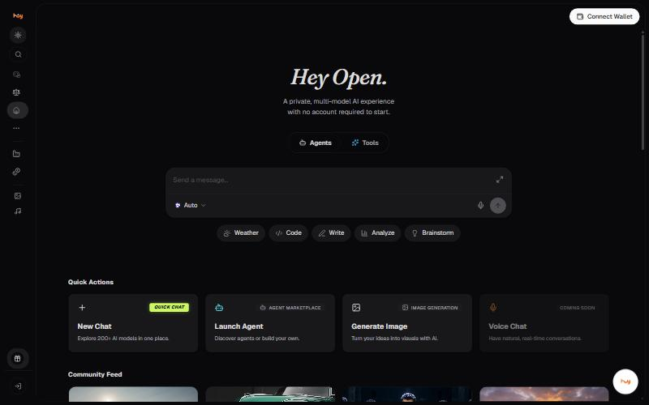
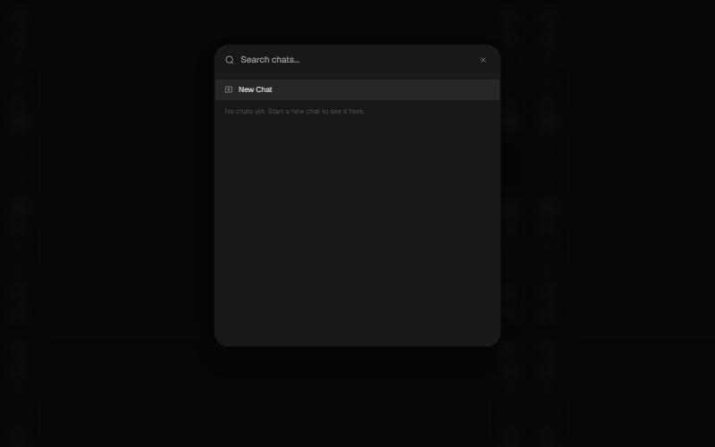

# Getting around the workspace

## The sidebar

| Icon | Goes to | State |
| --- | --- | --- |
| Theme | Switches between light and dark | Live |
| Search | Search your chats | Live |
| New Chat | Starts a fresh conversation | Live |
| Consensus | Consensus Mode | Pro plan and above |
| Home | Home screen, quick actions and community feed | Live |
| More | Further navigation | Live |
| Model Factory | Customize and train your own AI models | **Coming Soon** |
| Staking | Stake tokens to support the network | **Coming Soon** |
| Image Tools | 9 image tools | Live |
| Audio Tools | 3 audio tools | Live |
| Invite and earn $10 | Referral | Live |

## The header

- **Memory**, which opens the two memory switches.
- **Privacy**, which opens the Min / Mid / Max filter.
- **Connect Wallet**.

## The composer

- The model pill, reading **Auto** by default.
- The request mode pill, reading **Boost** by default.
- Voice input, and send.
- An expand control for a larger editor.

## The home screen

Four quick actions: **New Chat**, **Launch Agent** (Agent Marketplace),
**Generate Image**, and **Voice Chat** which is marked Coming Soon. Below
them is a **Community Feed** of dated image and video posts.

---

### Related

- [User flows](../reference/user-flows.md)
- [Screen reference](../reference/screens.md)

*Snapshot taken from the live application on 4 November 2026. The app is the source of truth; this page is a snapshot.*

