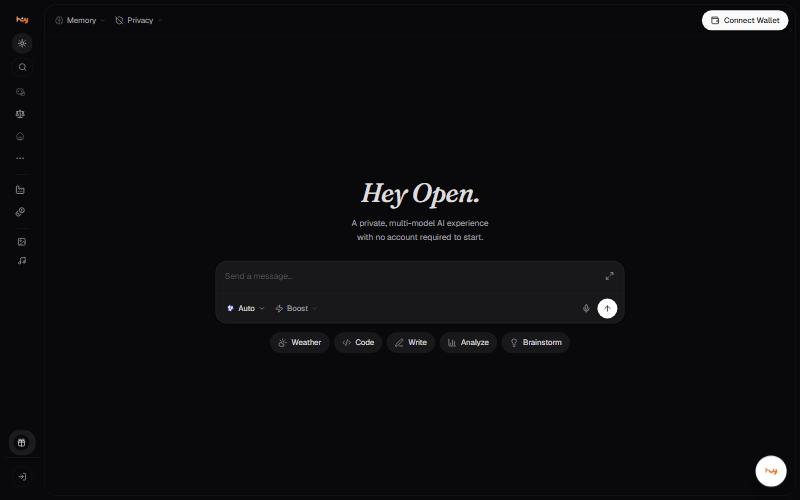
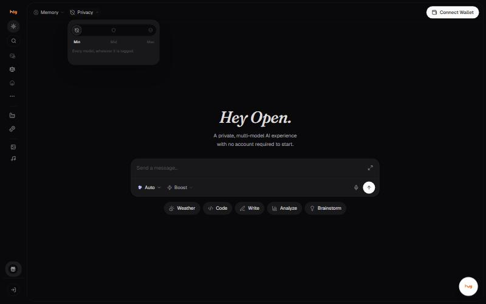
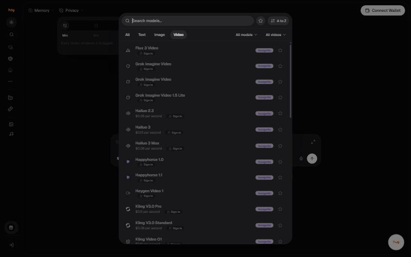
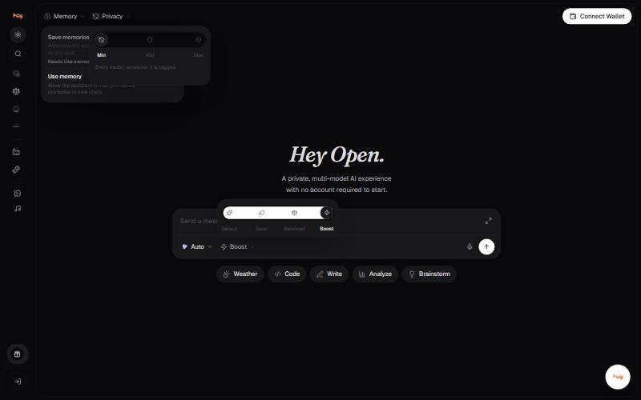
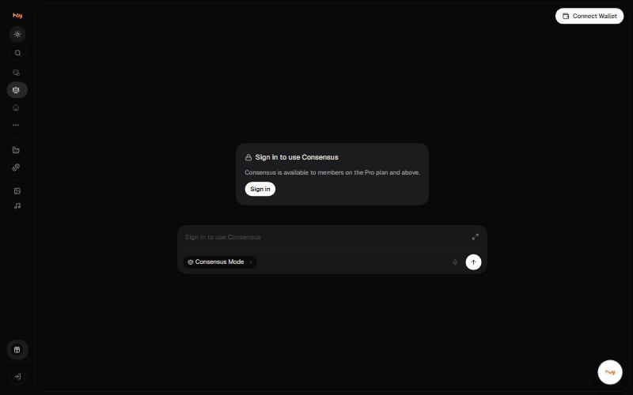
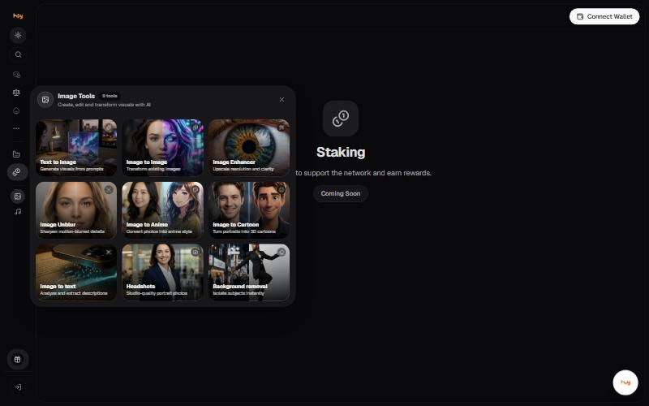
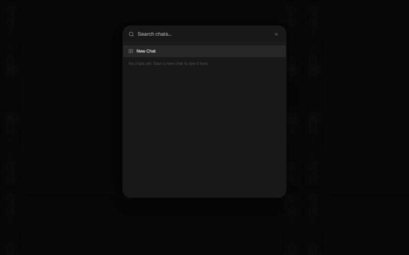
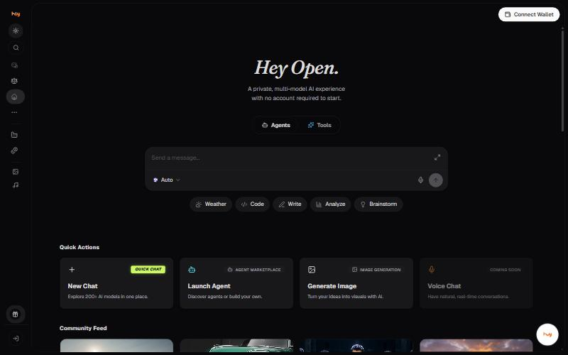

# Screen reference

Captured from the live application on 4 November 2026, signed out, at 1440x900.

## Chat

The default screen. Composer, model pill (**Auto**), request mode pill
(**Boost**), voice input, and five starter chips: Weather, Code, Write,
Analyze, Brainstorm.

## Privacy filter

Opened from **Privacy** in the header. Three settings, Min selected.

## Model picker

Search, A to Z sort, tabs for All / Text / Image / Video, favourites, and
per-second pricing on video models.

## Memory and request mode

Memory has two switches. Request mode has four settings.

## Consensus

Gated on sign-in and the Pro plan.

## Image Tools

Nine tools in a panel that opens over the current screen.

## Search

Searches your chats. Empty signed out.

## Home

Quick actions and the community feed.

---

### Related

- [User flows](user-flows.md)

*Snapshot taken from the live application on 4 November 2026. The app is the source of truth; this page is a snapshot.*

