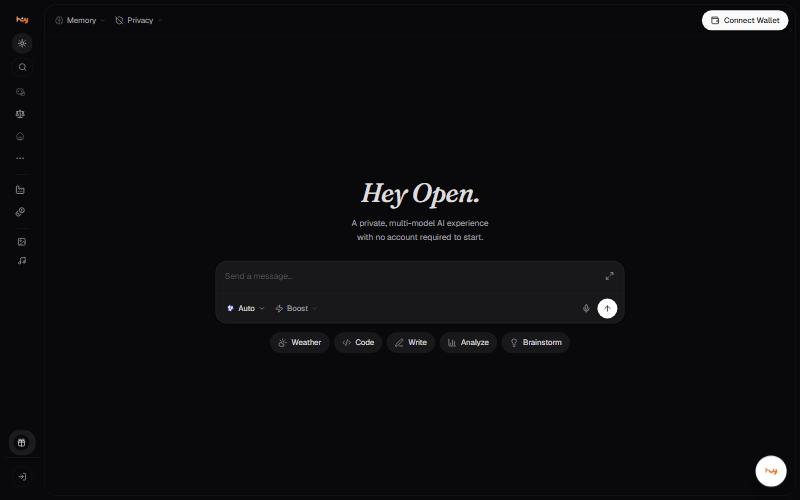
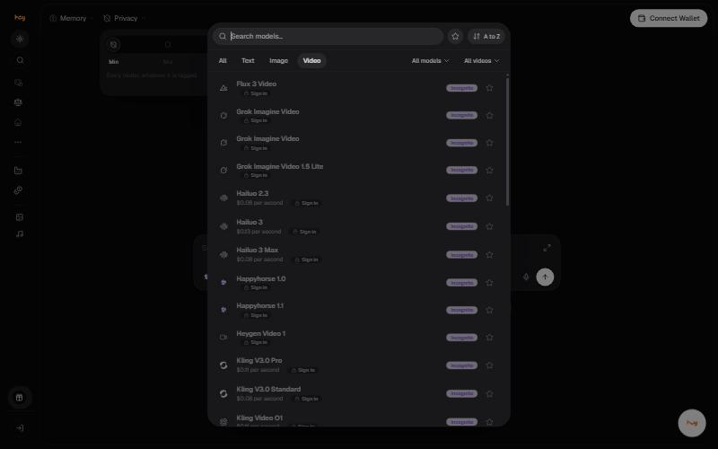
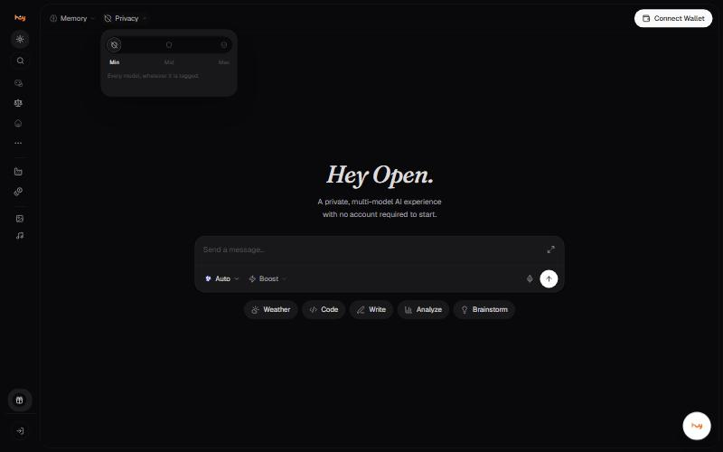
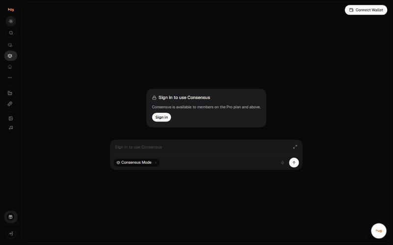
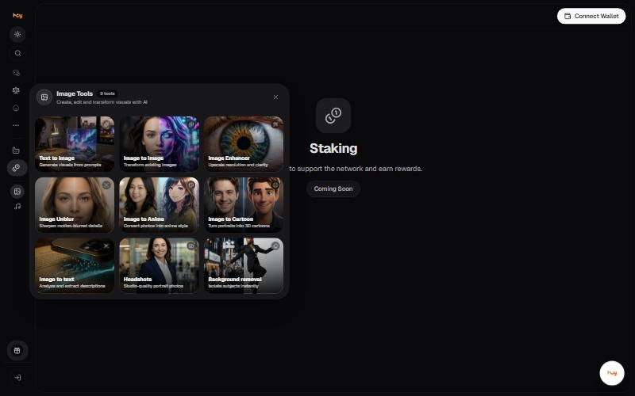

# User flows

Every flow below was walked in the live application on 4 November 2026,
signed out. Steps that require an account are marked.

## 1. First visit to first answer

```
Open ais.openledger.xyz
        |
        v
  Redirects to /chat  ........................ no wallet, no account needed
        |
        v
  Chat screen: composer, Auto model, Boost mode
        |
        +---> optional: set the privacy filter (Min / Mid / Max)
        +---> optional: open the model picker and choose a model
        |
        v
  Type a message and send
        |
        v
  SIGN IN REQUIRED  ........................... every model shows "Sign in"
```



**What this resolves:** the landing site says "no account required to
start" and the application does open without one. The gate is on
**sending**, not on arriving.

## 2. Choosing a model

```
Model pill (reads "Auto")
        |
        v
  Picker opens
        |
        +-- Search models
        +-- Tabs: All | Text | Image | Video
        +-- Sort: A to Z
        +-- Star a model to pin it
        |
        v
  Pick a model  ->  conversation continues, memory follows
```



The privacy filter is applied **before** this list is built. On **Max**
the picker only contains TEE and E2EE models.

## 3. Setting privacy

```
Header -> Privacy
        |
        v
  Min  ->  Every model, whatever it is tagged.
  Mid  ->  Private, TEE and E2EE models only.
  Max  ->  TEE and E2EE models only, hardware-protected prompts.
```



## 4. Setting request mode

```
Composer -> request mode pill (reads "Boost")
        |
        v
  Default  ->  Every model; the gateway picks the vendor.
  Saver    ->  Cheapest providers first.
  Balanced ->  A balance of speed and cost.
  Boost    ->  Fastest providers first.
```

Models marked **Not in Boost** leave the picker in Boost mode.

## 5. Consensus Mode

```
Sidebar -> Consensus
        |
        v
  /consensus
        |
        v
  "Sign in to use Consensus"
  "Consensus is available to members on the Pro plan and above."
```



## 6. Creating an image

```
Sidebar -> Image Tools            OR     Model picker -> Image tab
        |                                        |
        v                                        v
  Nine single-purpose tools              35 image models
  (Text to Image, Headshots, ...)        (Flux, Gemini, GPT, Grok, Seedream)
                                                 |
                                                 v
                                         "Image required" models
                                         need a source image
```



## 7. Dead ends

Two sidebar destinations render a Coming Soon page:

```
Sidebar -> Model Factory  ->  "Customize and train your own AI models."  [Coming Soon]
Sidebar -> Staking        ->  "Stake tokens to support the network..."   [Coming Soon]
Home    -> Voice Chat     ->  [Coming Soon]
```


**Staking is not live.** The marketing site describes staking, buybacks
and burns in the present tense. In the application it is a Coming Soon
page. Any help article describing how to stake would be documenting
something a user cannot do.



---

### Related

- [Screen reference](screens.md)
- [Open questions](open-questions.md)

*Snapshot taken from the live application on 4 November 2026. The app is the source of truth; this page is a snapshot.*


