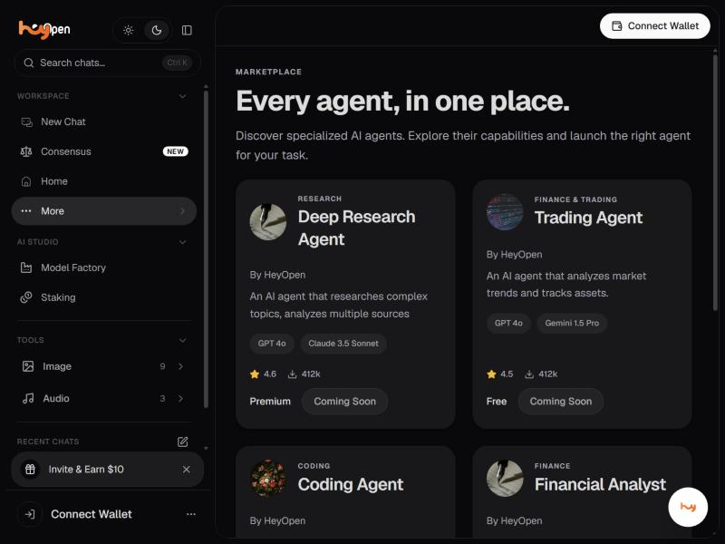

# Agents

The agent marketplace sits under **More** in the sidebar, at /agents.

The page describes itself as: every agent, in one place. Discover
specialized AI agents, explore their capabilities and launch the right
agent for your task.

| Agent | Category | What it does | Tier |
| --- | --- | --- | --- |
| **Deep Research Agent** | Research | Researches complex topics, analyzes multiple sources | Premium |
| **Trading Agent** | Finance & Trading | Analyzes market trends and tracks assets | Free |
| **Coding Agent** | Coding | Writes, debugs and optimizes code | Enterprise |
| **Financial Analyst** | Finance | Stock prices, company financials, earnings, SEC filings | Premium |
| **Web Research** | Research | Live web search with citations | Free |


**Every agent listed is badged Coming Soon.** The marketplace is
browsable, but no agent can be launched in the current build. The ratings
and download counts on the cards are placeholder values and should not be
quoted anywhere.


## Good to know

- Agents are tiered Free, Premium and Enterprise, which implies a plan gate once they ship.
- Each card lists the models the agent would use.
- The home screen **Launch Agent** quick action opens this same marketplace.


**Needs confirming:** When agents ship, what each tier costs, whether users can build their own, and how an agent run is charged.


---

### Related

- [Home and Community Feed](home.md)
- [What is Hey Open?](../getting-started/what-is-hey-open.md)

*Snapshot taken from the live application on 4 November 2026. The app is the source of truth; this page is a snapshot.*

