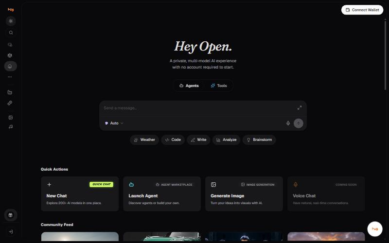

# Home and Community Feed

Home carries a composer, four quick actions, and a feed of community
posts.

## Quick actions

| Action | Label | Description | State |
| --- | --- | --- | --- |
| **New Chat** | Quick chat | Explore 200+ AI models in one place | Live |
| **Launch Agent** | Agent marketplace | Discover agents or build your own | Live |
| **Generate Image** | Image generation | Turn your ideas into visuals with AI | Live |
| **Voice Chat** | - | Have natural, real-time conversations | Coming Soon |

## Agents and Tools tabs

Two tabs sit under the hero, **Agents** and **Tools**, which change what
the home screen offers.

## Community Feed

A grid of dated image and video posts below the quick actions.


**Needs confirming:** Who can post to the community feed, whether posts are moderated, and whether a user can keep their generations out of it.


---

### Related

- [Agents](agents.md)
- [Getting around the workspace](../getting-started/workspace.md)

*Snapshot taken from the live application on 4 November 2026. The app is the source of truth; this page is a snapshot.*

